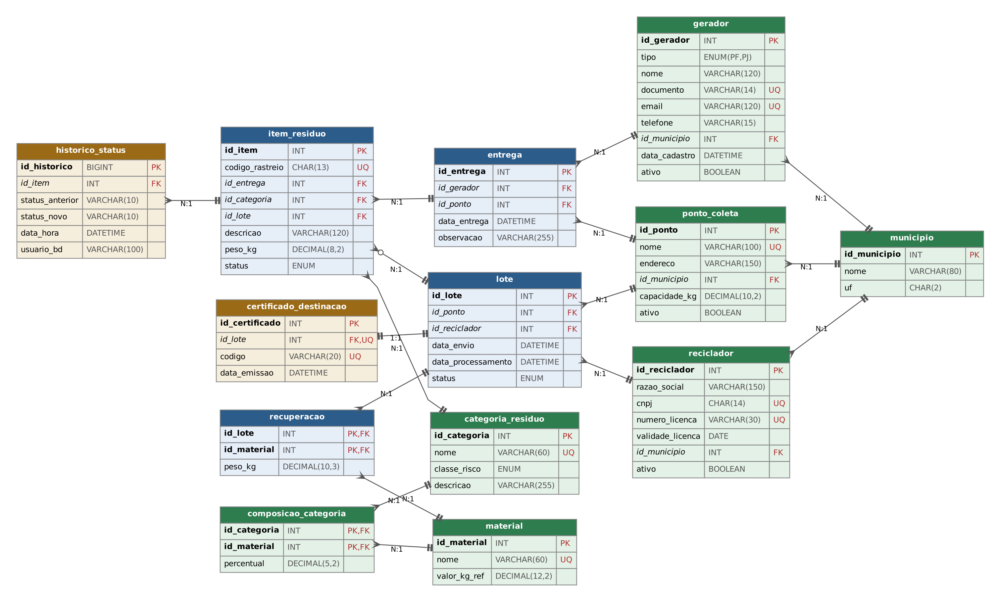
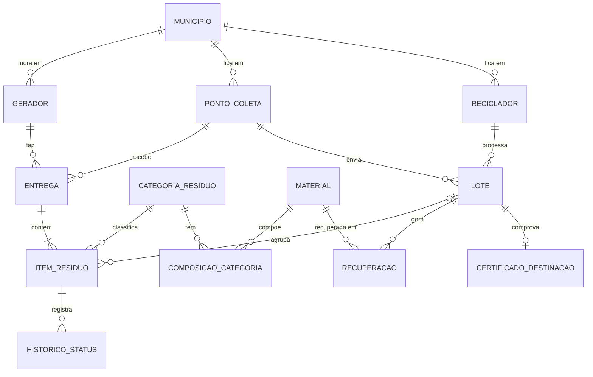

# EcoCircuito ♻️

**Banco de dados para economia circular de resíduos eletrônicos**
Projeto A3 – Banco de Dados · Universidade Anhembi Morumbi (Paulista)

| Integrante | RA |
|---|---|
| Lucas Chagas Brito | 12525151813 |
| Higor Monteiro de Andrade | 12525131878 |
| Luiz Henrique Villas Boas Tavares | 12525166769 |
| Marcus Vinicius Batista Oliveira | 12525156422 |

---

## O problema

Em 2022 o mundo gerou **62 milhões de toneladas** de lixo eletrônico e só **22,3%** teve coleta e reciclagem documentadas (Global E-waste Monitor 2024, ONU). No Brasil foram cerca de **2,4 milhões de toneladas** e apenas **3%** com coleta formal. O Decreto 10.240/2020 obriga a logística reversa de eletroeletrônicos, mas falta **dado confiável**: quem descartou, onde o item está, para quem foi e o que virou.

## A solução

O EcoCircuito é um banco relacional (MySQL 8) que rastreia cada eletrônico do descarte até a reciclagem:

```
Gerador entrega → Ponto de coleta (etiqueta com código) → Lote → Reciclador
→ Materiais recuperados (kg) → Certificado de destinação
```

- **Rastreio** de cada item por código (`EC-XXXXXXXXXX`), com histórico automático de status.
- **Cálculo dos materiais recuperados** (cobre, plástico, placas...) a partir da composição média de cada categoria.
- **Certificado de destinação** emitido automaticamente quando o lote é processado.
- **Bloqueio de reciclador com licença ambiental vencida.**
- **Gamificação**: ranking de geradores com 10 pontos por kg reciclado.
- **Indicadores de impacto** para prefeitura e cooperativas.

## Estrutura do repositório

```
sql/
  01_criar_banco.sql          criação do banco
  02_tabelas.sql              13 tabelas com PK, FK, UNIQUE e CHECK
  03_indices.sql              índices para as consultas mais usadas
  04_triggers.sql             5 triggers (código, histórico, validações)
  05_procedures.sql           4 procedures com transação (COMMIT/ROLLBACK)
  06_views.sql                6 views de rastreio e indicadores
  07_dados_teste.sql          carga de dados fictícios (via procedures)
  08_consultas_relatorios.sql 12 consultas de relatório
  09_seguranca.sql            perfis (roles), usuários e permissões
  10_testes_regras.sql        10 testes que devem falhar (prova das regras)
  11_monitoramento.sql        consultas de administração e monitoramento
scripts/
  backup.sh                   backup diário com mysqldump
  restaurar.md                passo a passo de restauração
docs/
  der_conceitual.png          modelo conceitual
  der_logico.png              modelo lógico (DER)
```

## Como rodar

Requisito: MySQL 8.0 ou superior.

```bash
cd sql
for f in 0*.sql; do mysql -u root -p < "$f"; done
mysql -u root -p < 09_seguranca.sql
mysql -u root -p --force < 10_testes_regras.sql   # os erros são esperados
```

No MySQL Workbench: abra cada arquivo na ordem (01 a 09) e execute com o raio ⚡.

## Modelo de dados





## Regras garantidas pelo banco

| Regra | Como |
|---|---|
| Peso entre 0 e 1000 kg | `CHECK ck_item_peso` |
| CPF com 11 dígitos, CNPJ com 14 | `CHECK ck_gerador_documento` |
| Documento, e-mail e código de rastreio únicos | `UNIQUE` |
| Não apagar município/gerador em uso | `FOREIGN KEY ... ON DELETE RESTRICT` |
| Status só avança (RECEBIDO → ENVIADO → RECICLADO) | trigger `trg_item_valida_status` |
| Lote só para reciclador com licença válida | trigger `trg_lote_valida_reciclador` |
| Entrega com vários itens é tudo ou nada | transação em `sp_registrar_entrega` |
| Ponto de coleta não passa da capacidade | `sp_registrar_entrega` com `SELECT ... FOR UPDATE` |
| Um certificado por lote | `UNIQUE (id_lote)` |

## Segurança

| Perfil | Pode |
|---|---|
| `eco_admin` | tudo no banco do projeto |
| `eco_operador_ponto` | consultar cadastros, registrar entrega, fechar lote (só via procedure) |
| `eco_reciclador` | ver rastreio e processar lote |
| `eco_analista` | só ler as views de indicadores (não vê CPF/e-mail) |

Backup diário completo + binary log para recuperar até o minuto da falha. Ver `scripts/`.

---
Dados de teste fictícios. Percentuais de composição e valores em R$/kg são referências ajustáveis.
